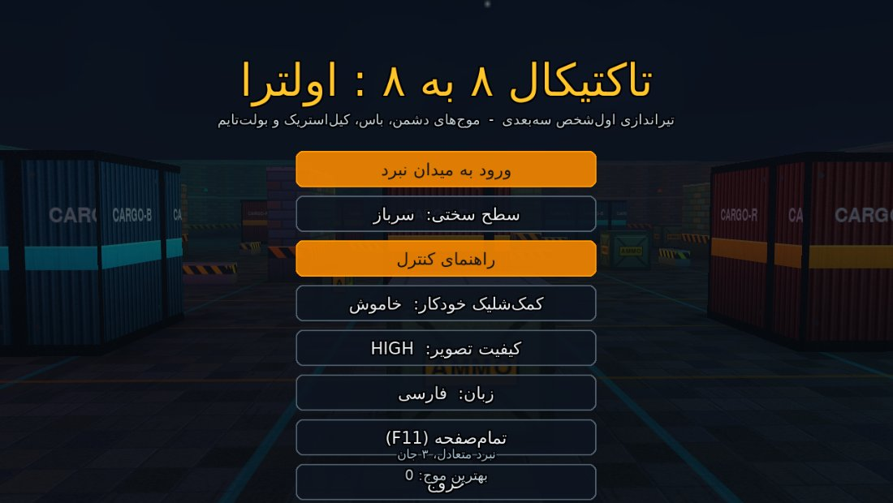
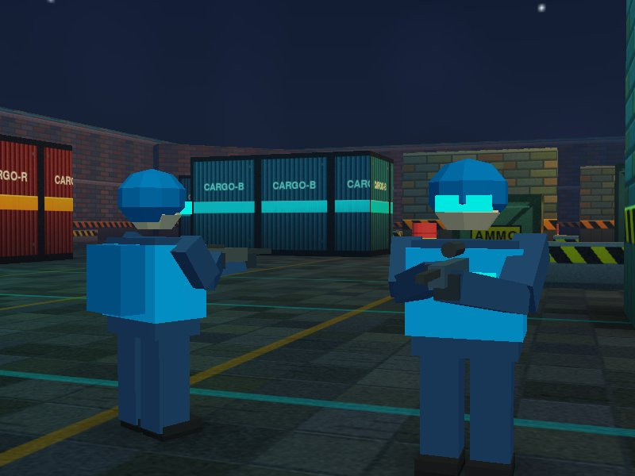

# TACTICAL 8v8 : ULTRA  —  نسخهٔ پایتون، **کاملاً سه‌بعدی**

تبدیل کامل بازی HTML (Three.js) به **پایتون** با موتور سه‌بعدی واقعی **Panda3D** — و بازی خیلی سخت‌تر، پرچالش‌تر و پرانرژی‌تر شده است.

* دنیا از **هندسهٔ سه‌بعدی واقعی** ساخته شده (دیوار، کانتینر، جعبه، کف، سقف‌ها)، با دوربین سه‌بعدی واقعی: بالا/پایین نگاه کردن، پرش، سُرخوردن، زوم واقعی.
* هر سرباز یک **مدل سه‌بعدی مفصل‌دار** است (پا، دست، سر، کلاه، سلاح) که راه می‌رود، می‌نشیند و می‌افتد — تصویر دوبعدی نیست. بشکه‌ها، تیربار، بسته‌های امدادی، چتر نجات، نارنجک و موشک هم مدل سه‌بعدی‌اند.
* سلاح دست تو هم مدل سه‌بعدی است (با دست‌ها)، با لرزش، لگد، عوض کردن و خشاب‌گذاری؛ در زوم واقعاً به مرکز می‌آید.
* مه، آسمان پرستاره، نور نئونی پخته‌شده روی دیوارها و زمین، سایهٔ زیر پای همه، انفجار و دود و جرقهٔ سه‌بعدی با پنهان‌شدن پشت دیوارها.
* هیچ فایل تصویر/صدایی لازم نیست؛ همه‌چیز هنگام اجرا ساخته می‌شود.


## اجرا

```bash
pip install panda3d pygame numpy arabic-reshaper python-bidi
python main.py
```

* به یک کارت گرافیک با OpenGL نیاز دارد (هر کارت یا گرافیک مجتمع معمولی کافی است).
* `arabic-reshaper` و `python-bidi` فقط برای **رابط فارسی** هستند؛ اگر نصب نباشند بازی انگلیسی اجرا می‌شود.
* اگر بازی کند بود: در منو «کیفیت تصویر» را روی LOW بگذار (لبه‌صاف‌کن و سایه‌ها خاموش می‌شود) یا `python main.py --size 960x540` بزن.
* یک فایل واحد می‌خواهی؟ `python make_single_file.py` ← فایل `tactical8v8_single.py`.
* نسخهٔ قدیمی‌تر با رندر نرم‌افزاری (بدون کارت گرافیک، ۲٫۵ بعدی): `python main_lite.py` (به `pygame` و `numpy` نیاز دارد).
* پایتون ۳٫۸ به بالا؛ ویندوز، مک و لینوکس.

## کنترل

| کلید | کار |
|---|---|
| `W A S D` + ماوس | حرکت و هدف‌گیری |
| کلیک چپ / راست | شلیک / زوم (اسکوپ برای اسنایپر) |
| `Shift` | دویدن (انرژی مصرف می‌کند) |
| `Ctrl` یا `C` | نشستن — هنگام دویدن: **سُرخوردن** |
| `Space` | پرش (از روی سنگرهای کوتاه هم می‌پری و روی آن‌ها می‌ایستی) |
| `R` | خشاب |
| `1`–`7` / چرخ ماوس | تعویض سلاح |
| `G` | نارنجک |
| `Q` | آمپول آدرنالین (درمان کامل + سرعت) |
| `T` | کاشتن تیربار خودکار |
| `V` | بمباران هوایی **روی نقطه‌ای که نشانه رفته‌ای** |
| `F` | **بولت‌تایم** (دنیا کند می‌شود، تو نه) |
| `B` | فروشگاه | 
| `Tab` | جدول امتیاز |
| `X` | کمک‌شلیک خودکار (مثل نسخهٔ HTML؛ پیش‌فرض خاموش) |
| `Enter` | شروع زودتر موج بعدی |
| `P` / `Esc` | توقف · `M` بی‌صدا · `F11` تمام‌صفحه |

## چه چیزهایی از نسخهٔ HTML آمده؟

نقشهٔ ۱۰۸×۱۰۸ سه‌مسیره با گوشه‌های ۴۵ درجه، کانتینرهای آبی/قرمز، جعبه‌ها، بشکه‌های انفجاری، چراغ‌های نئونی رنگی و آسمان پرستاره ·
۷ سلاح (M4A1، AK-47، اسنایپر، Vector، شات‌گان ۸ ساچمه‌ای، RPG-7، مینی‌گان M134) · نارنجک، آمپول، بمباران هوایی، تیربار خودکار ·
آسیب نقطه‌ای (سر، سینه، دست، پا) روی دشمن **و** روی تو (دست‌آسیب‌دیده = لرزش نشانه، پا = کندی) · فروشگاه ·
۸ به ۸ با دشمنانی که سلاحشان را هوشمندانه عوض می‌کنند و از مسیر چپ/راست/وسط دور می‌زنند —
حالا از جاهایی که تو دشمن می‌کشی «یاد می‌گیرند» و از طرف مخالف می‌آیند.

## چه چیزهایی اضافه شد؟ (خیلی خفن‌تر!)

**نبرد موجی با باس**
* موج‌های بی‌پایان؛ هر موج بزرگ‌تر و سخت‌تر. هر ۵ موج یک **فرمانده (Warlord)** با RPG و مینی‌گان می‌آید و در نیمهٔ جانش نیرو صدا می‌زند.
* ۶ نوع دشمن: **Grunt**، **Rusher** (سریع، شات‌گان)، **Marksman** (اسنایپر با **لیزر قرمز** — هشدار می‌دهد، باید از دیدش خارج شوی)، **Heavy** (مینی‌گان، زره‌دار)، **Grenadier** (نارنجک پشت سنگر تو می‌اندازد)، **Warlord**.
* سطح سختی (تازه‌کار تا افسانه‌ای با **فقط یک جان**)، جان محدود، رکورد ذخیره می‌شود.

**هوش مصنوعی واقعی**
* مسیریابی با «میدان جریان» (flow-field) روی نقشه؛ همه دور سنگرها می‌روند، گیر نمی‌کنند.
* نقش‌ها: هجوم، دورزن، تک‌تیرانداز مستقر. استتار، نشستن، پیک زدن، عقب‌نشینی با جان کم، پرتاب نارنجک.
* دقتشان به فاصله، سرعت تو، نشستن/سرخوردن/پریدن و تأخیر واکنش بستگی دارد. تیر خطا → صدای «ویز» و لرزش صفحه.
* هم‌تیمی‌ها واقعاً می‌جنگند، می‌میرند، و هر چند وقت نیروی کمکی می‌رسد.

**حرکت و تیراندازی**
* سُرخوردن، پرش و **عبور از سنگر کوتاه**، انرژی دویدن، سنگرهای کوتاه واقعی: پشتشان که بنشینی دشمن دیگر تو را نمی‌بیند (تا وقتی بلند شوی).
* بازگشت لگد سلاح، پخش گلوله (bloom) در رگبار، ADS دقیق‌تر، اسکوپ اسنایپر با لرزش نفس، مینی‌گان با چرخش گرم‌شدن.
* **بولت‌تایم**: با کشتن دشمن (مخصوصاً هدشات) شارژ می‌شود.

**جایزه و اقتصاد**
* کیل‌استریک: ۳ = پهپاد (همهٔ دشمن‌ها روی رادار و صفحه) · ۵ = بمباران · ۸ = تیربار + زره · ۱۲ = تمرکز کامل.
* کمبوی چندکشی (Double/Triple/RAMPAGE)، **LONGSHOT**، هدشات، جایزهٔ موج، **بستهٔ امدادی با چتر** از آسمان.
* فروشگاه ۱۲ آیتمه: اسلحه‌ها + ارتقاهای دائمی (گلولهٔ اورانیومی، زره سنگین، دست‌های سریع، خشاب بزرگ، باتری تمرکز).
* بشکه‌های قرمز زنجیره‌ای منفجر می‌شوند — کل گروه دشمن را با یک تیر بزن!

**ظاهر و صدا**
* موتور سه‌بعدی Panda3D: هندسهٔ واقعی با ارتفاع‌های مختلف (از روی سنگر کوتاه دشمن را می‌بینی)، نور نئونی پخته‌شده، آسمان پرستاره، مه، سایه‌های تماسی.
* ۹ نوع سرباز سه‌بعدی مفصل‌دار، مدل سه‌بعدی اسلحه و دست در دید اول‌شخص، ردگلوله، انفجار، دود، جرقه، پوکه.
* بیش از ۳۰ افکت صوتی ساخته‌شده با ریاضی (هیچ فایل صوتی نیست) با **صدای جهت‌دار** و ضربان قلب وقتی جانت کم است.
* رابط **فارسی و انگلیسی** (کلید زبان در منو).

| | |
|---|---|
|  |  |
|  |  |

## ساختار پروژه

| فایل | کار |
|---|---|
| `main.py` | برنامهٔ اصلی سه‌بعدی (Panda3D): پنجره، ورودی، منو |
| `p3_scene.py` | همگام‌سازی صحنهٔ سه‌بعدی با بازی، افکت‌ها، سلاح دست |
| `p3_world.py` | ساخت هندسهٔ سه‌بعدی میدان، نور پخته‌شده، آسمان و مه |
| `p3_models.py` | مدل‌های سه‌بعدی: سرباز، بشکه، تیربار، اسلحه‌ها… |
| `p3_geom.py` | ابزار ساخت مش و بافت برای Panda3D |
| `t8_game.py` | بازیکن، سلاح‌ها، آسیب، انفجار، موج‌ها، فروشگاه |
| `t8_entities.py` | هوش مصنوعی سربازها، تیربار، نارنجک، موشک |
| `t8_world.py` | نقشه، برخورد، پرتاب پرتو، مسیریابی |
| `t8_ui.py` | HUD، منوها، متن فارسی (روی صفحهٔ سه‌بعدی می‌نشیند) |
| `t8_audio.py` | صداسازی |
| `t8_data.py` | سلاح‌ها، دشمن‌ها، سختی، فروشگاه، همهٔ متن‌ها |
| `t8_textures.py` / `t8_models.py` | بافت‌ها و تعریف مدل‌ها |
| `main_lite.py` + `t8_render.py` + `t8_scene.py` | نسخهٔ قدیمی رندر نرم‌افزاری |

برای تغییر تعادل بازی (آسیب، تعداد دشمن، قیمت‌ها…) فقط `t8_data.py` را ویرایش کن.

---
**English:** a fully 3D Python port (Panda3D engine) of the Three.js tactical 8v8 shooter: real 3D geometry and articulated 3D soldiers, wave/boss gameplay,
navigation AI, killstreaks, bullet-time, procedural audio and a Persian/English UI.  `pip install panda3d pygame numpy arabic-reshaper python-bidi && python main.py`
